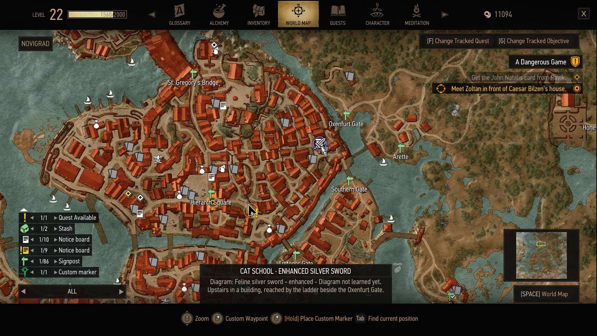
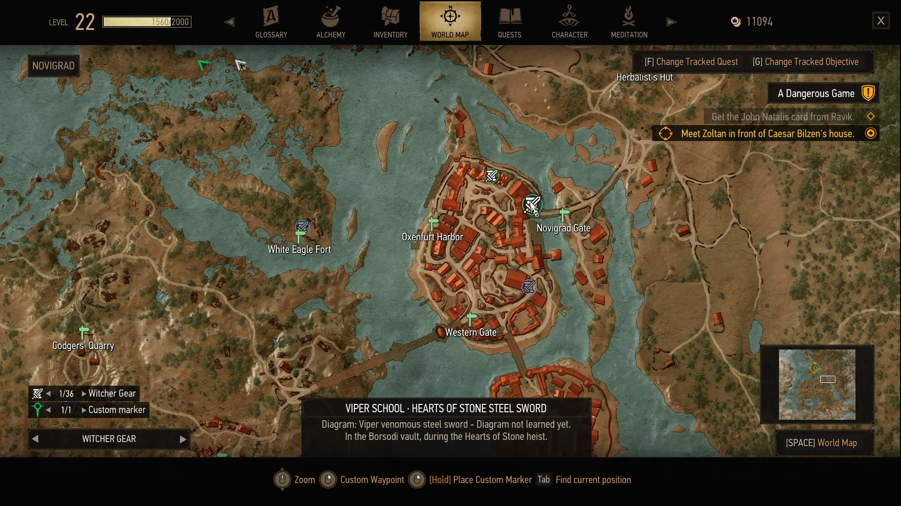
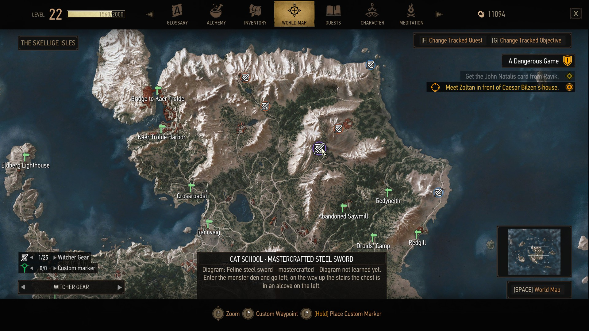
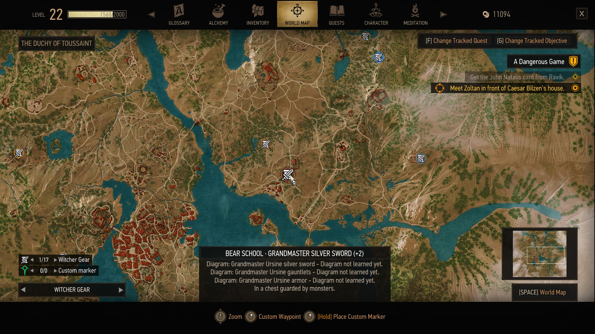
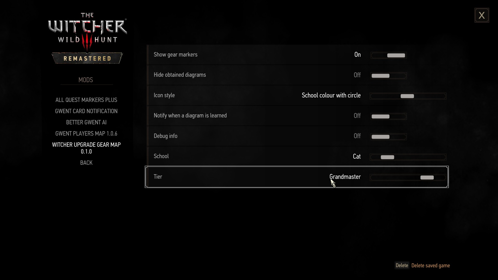
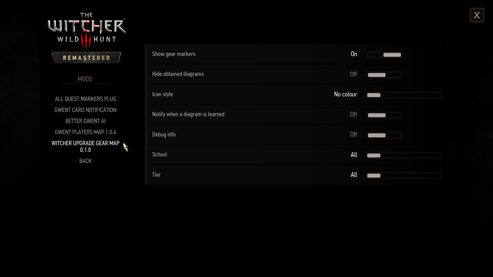

# Witcher Upgrade Gear Map

A map mod for The Witcher 3 (patch 5.01, Steam/GOG Remastered). It marks every witcher gear
diagram on the world map, tells you where the chest is, and turns grey once Geralt has learned it.

I tested the mod in game myself (DX12, Linux/Proton), together with Gwent Players Map.

| Hearts of Stone source | Skellige, school colour with circle |
| --- | --- |
|  |  |

| One chest, several diagrams | Options |
| --- | --- |
|  |  |

## Features

- **135 diagrams at 89 locations**: Cat, Griffin, Bear, Wolf, Viper and Manticore, from Basic to
  Grandmaster, plus the Hearts of Stone Viper diagrams.
- **White** while a diagram is missing, **grey** once every diagram at that spot is learned.
  Diagrams you learned before installing the mod are recognized.
- **Where to look**: the tooltip says where the chest is, for example "Upstairs in a building,
  reached by the ladder beside the Oxenfurt Gate." (46 locations; the rest show a generic hint).
- **School-aware title** such as *Cat School · Enhanced Silver Sword*. A chest with several
  diagrams uses one marker, `(+N)` in the title, and lists each diagram with its own status.
- A **Witcher Gear** map filter with its own legend row and count. Markers also show under All.
- **No spoilers by default**: a marker appears once that scavenger hunt objective is in your
  journal (or once you know the diagram). Switch to *All* to see every location.
- **New Game+**: Wolf and Manticore have their own NG+ diagrams; their markers say *(Legendary)*
  and use the game's NG+ names. For the other schools, the tooltip notes that the crafted item is
  Legendary in NG+ (the diagram itself is the same).
- **18 languages**. Diagram names come from the game's own translations.

## Options

**Options > Mods > Witcher Upgrade Gear Map**

- **Show gear markers**: turns all markers on or off.
- **Show diagrams**: *Discovered only* (default) shows a location once its scavenger hunt
  objective is in your journal; *All* shows every location.
- **Hide obtained diagrams**: show only what you still need.
- **Icon style**: No colour (default), School colour with circle, School colour without circle.
- **Notify when a diagram is learned**: a short message when you pick up a new diagram.
- **School** and **Tier**: show only one school and/or one tier.
- **Debug info**: for bug reports.

## Installation

1. Extract `WitcherGearMap.zip` into the game folder (the one with `bin` and `content`).
2. If `bin/config/r4game/user_config_matrix/pc/dx11filelist.txt` and `dx12filelist.txt` exist,
   add the line `modWitcherGearMap.xml;` to both.
3. Start the game; the scripts compile on the first launch.

Using **Gwent Players Map** too? Both mods replace the world map, so install the optional
`WitcherGearMap-GwentPlayersMap-Combined.zip` as well (see below).

### Gwent Players Map compatibility

The combined file contains one world map with both mods' icons and filters
(`mods/mod0WitcherGearGwentMap`). Keep both mods installed; their scripts and texts stay
separate. The combined folder must load before the other two: its name already sorts first, but
if your `mods.settings` sets priorities, give it the lowest number. Remove it to go back to
either standalone map.

Other mods that replace the world map need a merged map file, for example with
[World Map Merger](https://www.nexusmods.com/witcher3/mods/13846) (I have not tested it).

## Save safety

The mod only reads the list of learned diagrams (`GetCraftingSchematicsNames`). It changes no
items, recipes, loot or quests and writes nothing to your save. Uninstalling leaves your
learned diagrams as they are.

## Uninstallation

Delete `mods/modWitcherGearMap`, `mods/mod0WitcherGearGwentMap` (if installed),
`bin/config/r4game/user_config_matrix/pc/modWitcherGearMap.xml` and its lines in the filelists.

## Notes

- Three Grandmaster Wolf diagrams have two nearby sources; both are marked.
- Countess Mignole's Hearts of Stone auction can be missed; the marker shows the source, not
  whether the quest still allows it.
- New Game+: tested with an NG+ save (Legendary names). A full NG+ playthrough is not tested.
- Translations other than English and Brazilian Portuguese are machine-assisted; corrections
  are welcome. [Translation template](translations/TEMPLATE.csv): keep the key and placeholders,
  translate the text after `;`.
- [Item list](data/items.csv) with coordinates and sources; [validation report](data/VALIDATION.md).

## Changelog

- **1.0.1**: "Show diagrams: Discovered only / All" option (Discovered only by default: markers
  follow your scavenger hunt journal). New Game+: *(Legendary)* in the title for Wolf and
  Manticore NG+ diagrams, and a note for the other schools; the Manticore NG+ diagrams showed
  their name in English in every language and now use the game's translated name. Debug info also shows learned and hidden counts.
- **1.0.0**: first release.

## AI disclosure

This mod was made with AI assistants (OpenAI Codex and Claude, by Anthropic): the scripts, the
data, the map icon and the translations were written with AI, and I tested the mod in game
myself. It is a hobby project.

## Credits

- Locations and the location hints are based on [witcher3map.com](https://witcher3map.com) by
  untamed0 and contributors ([source](https://github.com/witcher3map/witcher3map),
  [CC BY-NC-SA 4.0](https://creativecommons.org/licenses/by-nc-sa/4.0/)), checked against the
  game files; positions come from the game, and the hints are reworded.
- Built on Gwent Players Map (same author).
- [JPEXS Free Flash Decompiler](https://github.com/jindrapetrik/jpexs-decompiler) for the map file.
- The Witcher 3 and its assets belong to CD PROJEKT RED.

## License

[CC BY-NC-SA 4.0](LICENSE), noncommercial. Not enrolled in Nexus Donation Points.
